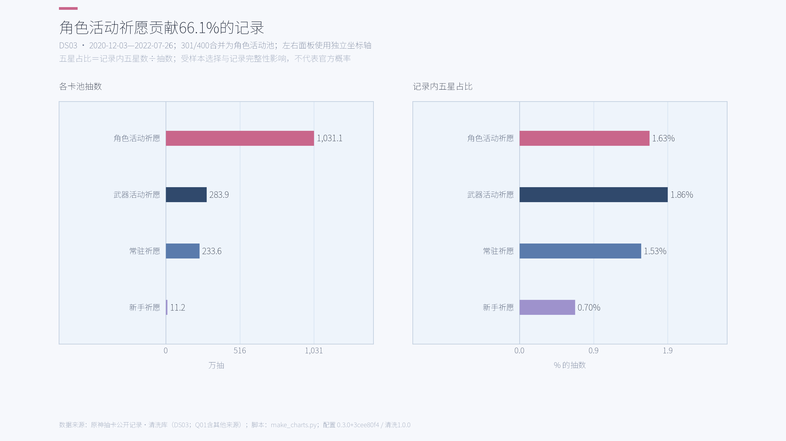
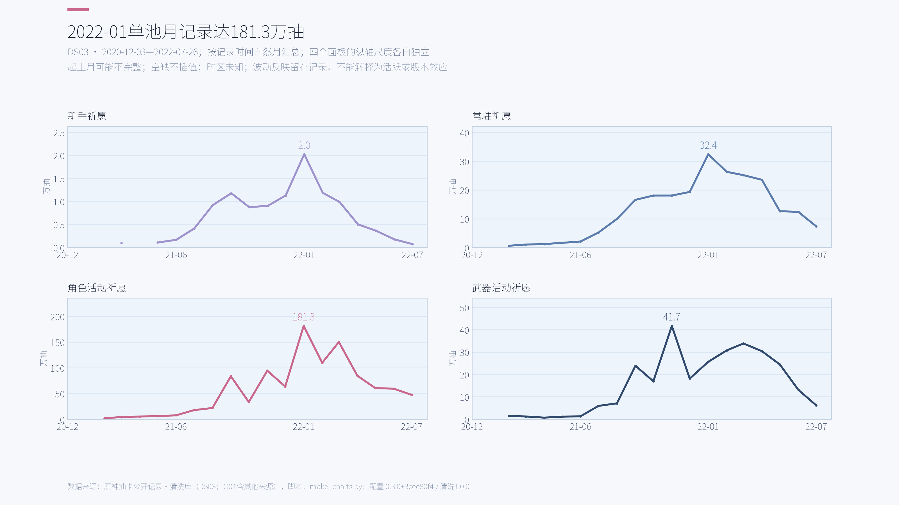
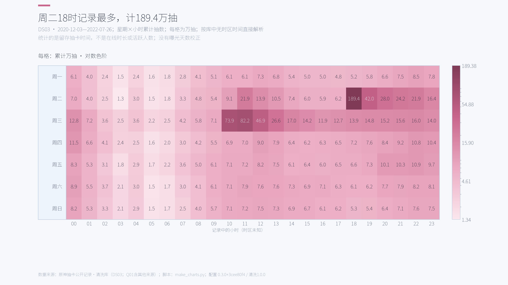
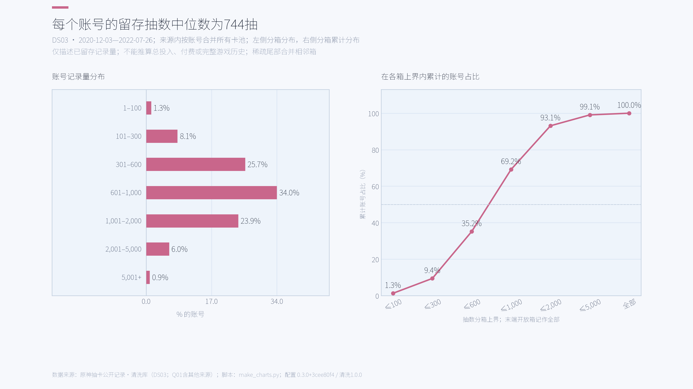
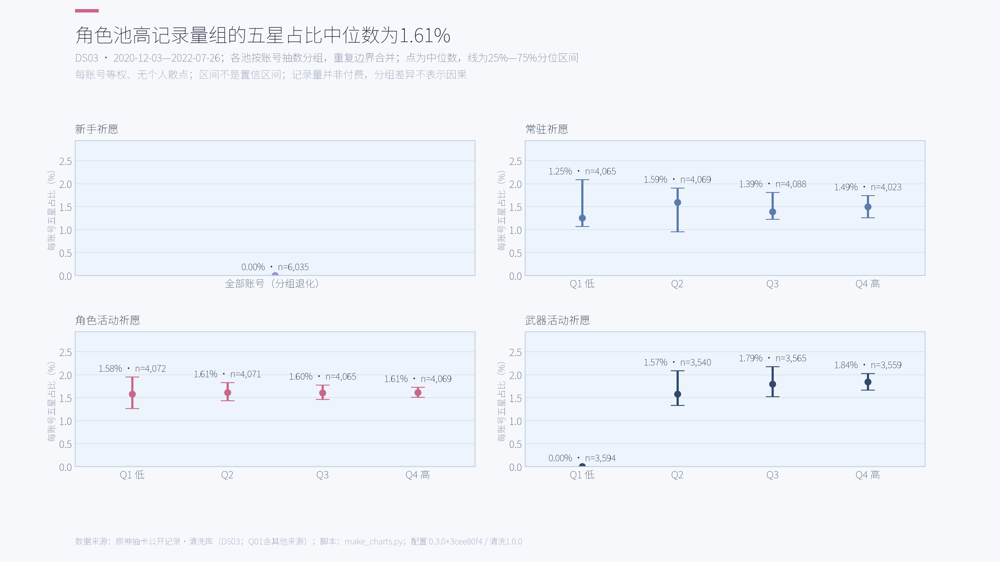
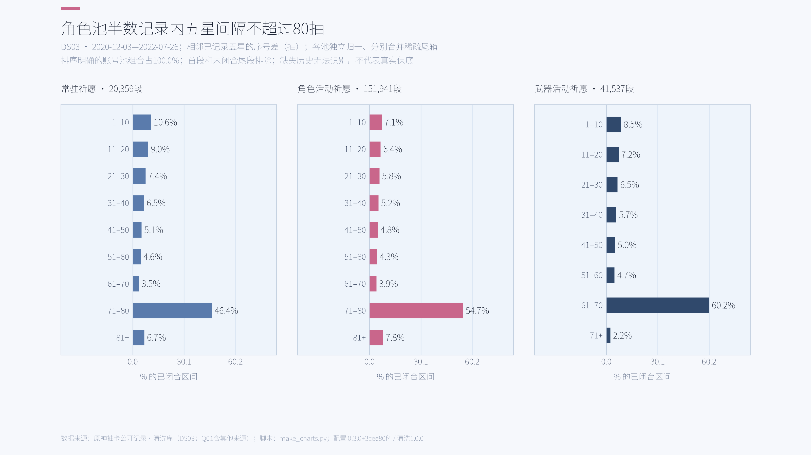
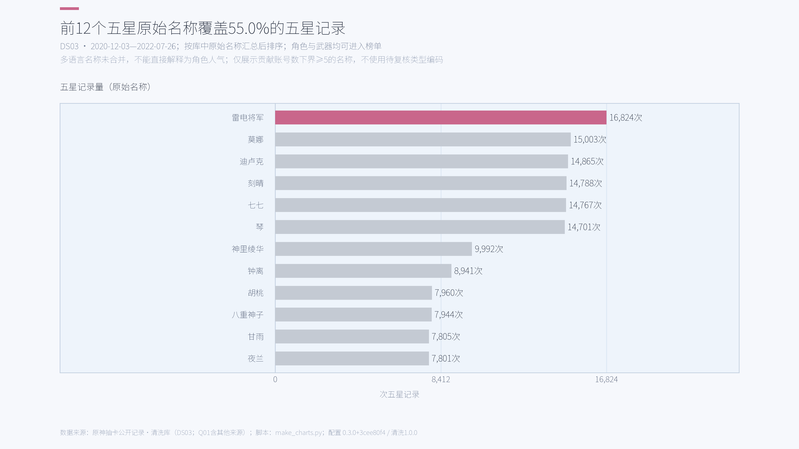

# 原神留存抽卡记录分析

主分析 DS03：16,289 个账号，15,598,804 抽。
记录范围：2020-12-03 23:35:23—2022-07-26 20:57:25（时区未知）。

这是所提供公开记录的描述性分析；来源内去重，不代表全部玩家。抽数不能换算付费或活跃；记录可能缺失。
不使用待复核物品类型做分类，不合并多语言名称；记录内五星占比和间隔不能替代官方概率或保底规则。

## 图表与结论

### 角色活动祈愿贡献66.1%的记录

### 2022-01单池月记录达181.3万抽

### 周二18时记录最多，计189.4万抽

### 每个账号的留存抽数中位数为744抽

### 角色池高记录量组的五星占比中位数为1.61%

### 角色池半数记录内五星间隔不超过80抽

### 前12个五星原始名称覆盖55.0%的五星记录

## 复现与保护

在项目根目录运行 `python make_charts.py --database <清洗库路径>`。未安装包时先设置 `PYTHONPATH=src;.`。
入口通过本地 import 调用 ADS、绘图和主题；首次运行需安装项目的 analysis、viz 依赖及开源中文字体。
配置：0.3.0+3cee80f4；全部为16:9、3200×1800像素、200 dpi；保存前执行主题自检。
不足5个贡献账号的格子在ADS置空并做互补抑制；分布合并相邻箱。月份、名称与间隔分箱的贡献人数使用保守下界。
ADS不含账号或抽卡标识；输入清洗库只读。复现信息见 manifest.json，发布的聚合见 ads.json。
